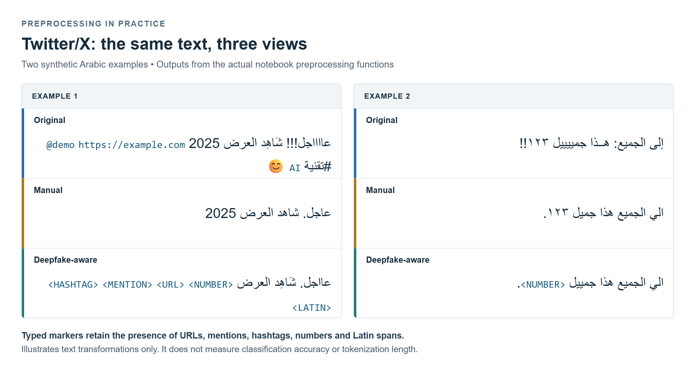
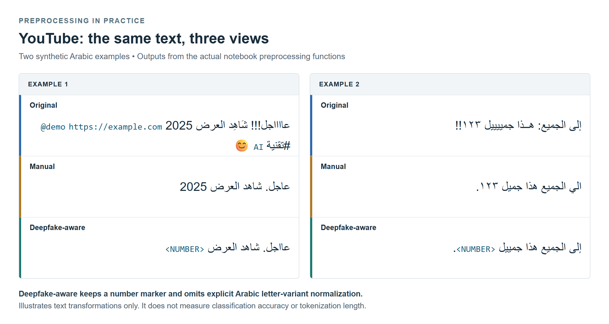

# Notebook guide and preprocessing examples

This guide explains the public notebooks and maps every code cell to its section and main definitions or variables. Cell numbers are **one-based positions counting both Markdown and code cells**, not execution counters. They describe the publication snapshot; editing or inserting cells changes the numbering.

## Reading and execution order

1. Read the root [README](README.md) for environment setup, authorized data paths, label semantics, and fixed splits.
2. `EDA.ipynb` explores local data. It is optional for understanding the experiments and can display private text samples.
3. The Twitter/X and YouTube notebooks each load and validate data, define platform-specific preprocessing, construct representations, train classifiers, evaluate predictions, and produce statistics and error analyses. Review the configuration before running either complete pipeline.
4. The multilingual notebook adds mBERT/XLM-R in-domain comparisons. Outside Colab, skip its final two Google Drive export cells.
5. The two evaluation notebooks analyze existing predictions and metadata. They embed their helpers and do not require the private `evaluation_support/` directory. They do require the model-run artifacts under `Output/`; they do not train missing models for you.

Do not run isolated training/evaluation cells without their earlier setup and data preparation. Keep each model paired with its fitted features, preprocessing view, tokenizer, and run metadata. Source-to-target transfer must use the source model's pipeline without refitting it on the target test data.

## What the main notebook stages do

| Stage | Input and operation | Output or check |
| --- | --- | --- |
| Configuration and imports | Project paths, libraries, seed and model settings | A consistent runtime and output location |
| Split preparation | Existing train/validation/test CSVs; text/label normalization and test-overlap audit | Fixed, checked partitions; test data stays held out |
| Preprocessing helpers | Character, token, whitespace, URL and script-handling functions | Three alternative views, evaluated separately |
| Feature construction | Training texts transformed to TF-IDF, Word2Vec/FastText summaries or token sequences | Model-specific representations; learned features fit on training only |
| Classical classifiers | Sparse or aggregated features | SVM, logistic-regression and random-forest predictions |
| Sequence models | Padded sequences and embeddings | LSTM/Bi-LSTM predictions |
| Transformers | Model-specific tokenizers and pretrained encoders | Fine-tuned classifier predictions; maximum input length is configured in the notebook |
| Evaluation and export | Held-out predictions and true labels | Metrics, paired comparisons, plots and saved prediction artifacts |
| Cross-platform tests | Source-trained model and the other platform's test set | Transfer scores without target-platform retraining |
| Error analysis | Predictions joined with text/category metadata | FP/FN and deception-category diagnostics; potentially private exports |

Code definitions configure behavior; they do not themselves establish a performance improvement. The original view already starts from a cleaned corpus. A shorter or more normalized text is not automatically easier to classify.

## Preprocessing examples from the actual functions

The following inputs are **synthetic Arabic demonstrations, not dataset quotations**. Outputs were produced by extracting the preprocessing functions and their dependencies from the platform notebooks (Manual: cell 35; Deepfake-aware: cell 36). Odd-character patterns were fitted using each platform's local training partition, after the same exact-text test-overlap removal. No model training or prediction was performed for these examples.

They demonstrate **what changes**, not that a view improves accuracy. The two platforms intentionally have different Deepfake-aware implementations.

### Twitter/X

| View | Example 1 | Example 2 |
| --- | --- | --- |
| Original | `عااااجل!!! شَاهِد العرض 2025 https://example.com @demo #تقنية AI 😊` | `إلى الجميع: هــذا جمييييل ١٢٣!!` |
| Manual | `عاجل. شاهد العرض 2025` | `الي الجميع هذا جميل ١٢٣.` |
| Deepfake-aware | `عااجل. شَاهِد العرض <NUMBER> <URL> <MENTION> <HASHTAG> <LATIN>` | `الي الجميع هذا جمييل <NUMBER>.` |

### YouTube

| View | Example 1 | Example 2 |
| --- | --- | --- |
| Original | `عااااجل!!! شَاهِد العرض 2025 https://example.com @demo #تقنية AI 😊` | `إلى الجميع: هــذا جمييييل ١٢٣!!` |
| Manual | `عاجل. شاهد العرض 2025` | `الي الجميع هذا جميل ١٢٣.` |
| Deepfake-aware | `عااجل. شاهد العرض <NUMBER>` | `إلى الجميع هذا جمييل <NUMBER>.` |

### How to interpret these differences

- **Manual, both platforms:** removes URLs, mentions, hashtags, emojis and Latin spans; removes diacritics; normalizes Arabic letter variants, tatweel and repetition. The number text is not replaced by a typed number marker.
- **Twitter/X Deepfake-aware:** represents URLs, mentions, hashtags, numbers and Latin spans with `<URL>`, `<MENTION>`, `<HASHTAG>`, `<NUMBER>` and `<LATIN>`. It omits the explicit diacritic-removal step and allows up to two repeated characters. Subsequent character filtering still determines the final output shown above.
- **YouTube Deepfake-aware:** uses `<NUMBER>` but removes the other listed social-media elements. It omits explicit alef/yeh/hamza normalization, removes diacritics and allows up to two repeated characters.
- Token markers must be handled by the corresponding tokenizer/representation configuration. These examples do not measure tokenization length or detector confidence.

## Complete code-cell inventory

For the measured model-level comparison, see the [in-domain results image](README.md#in-domain-results). Those results are separate from these synthetic text demonstrations.

Each expandable table covers every code cell in that notebook. Purpose labels come from the notebook's own nearby headings or leading comments; definitions and variable names are extracted from source, not inferred from saved outputs. Consult the cell itself for full parameters and control flow. Markdown cells are represented through the section labels rather than duplicated verbatim here.

Arabic_Deepfake_Detection_Twitter.ipynb — 110 code cells / 202 total cells

[Open notebook](Arabic_Deepfake_Detection_Twitter.ipynb)

| Cell | Purpose / section | Main code elements |
| ---: | --- | --- |
| 4 | Local runtime: no automatic restart. | Executes the surrounding section logic; see source |
| 5 | Dependencies are managed by the local Python environment; see README.md. | Executes the surrounding section logic; see source |
| 6 | Environment and Imports | Imports: `gc`, `importlib`, `json`, `os`, `random`, `re`, `string` (+20); Calls: `filterwarnings` |
| 8 | Fix the random state once so every model family is compared under the same seed. | Defines: `resolve_output_root`, `resolve_dataset_paths`; Sets: `SEED`, `torch`, `DEVICE`, `PROJECT_ROOT`, `DATASET_ROOT`, `OUTPUT_ROOT`, `PIPELINE_NAME` (+6); Calls: `seed`, `manual_seed`, `mkdir`, `print` |
| 9 | Force Python to re-read the files from disk | Imports: `importlib`, `exact_model_preprocessing_figures_helpers`, `deceptive_type_error_analysis_helpers`; Calls: `reload` |
| 10 | Paths, Seeds, and Dataset Roots | Imports: `exact_model_preprocessing_figures_helpers`, `deceptive_type_error_analysis_helpers` |
| 12 | Output Directories and Run Paths | Sets: `CANONICAL_OUTPUT_ROOT`, `PIPELINE_ROOT`, `RUN_ROOT`, `OUTPUT_DIR`, `RESULTS`, `FIG_DIR`, `TABLE_DIR` (+14); Calls: `mkdir` |
| 14 | Shared Labels and Utilities | Defines: `require_globals`, `log`, `resolve_publication_font`, `apply_shared_plot_style`, `to_paper_label`; Sets: `LOG_FILE`, `PALETTE`, `PREPROCESSING_ORDER`, `PREPROCESSING_PAPER_LABELS`, `PREPROCESSING_LABELS`, `PREPROCESSING_SHORT_LABELS`, `CORE_PREPROCESSING` (+12); Calls: `apply_shared_plot_style`, `print` |
| 16 | Persistence and Plot Helpers | Defines: `save_figure`, `save_json`, `write_dataframe_with_markdown`, `load_json`, `ensure_plotly_backend`, `save_figure_plotly`, `_df_from_ds`; Sets: `_PLOTLY_READY` |
| 19 | Load the split files into one clean schema for every downstream branch. | Defines: `_norm_ws`, `_read`, `_mk_ds`, `_sz`; Sets: `ds_twt`, `RAW_SPLIT_SIZES`; Calls: `print` |
| 21 | Run an exact-text leakage audit before any feature fitting or model training. | Defines: `_to_set`, `check`; Sets: `tests` |
| 23 | Remove exact test duplicates from train/val so the held-out split stays clean. | Defines: `_sanitize_deleak`, `_sz`; Sets: `ds_twt`, `FINAL_SPLIT_SIZES`; Calls: `print` |
| 25 | LOAD DATA (TWITTER ONLY - FROM PIPELINE SPLITS) | Defines: `_df_from_ds`; Sets: `twitter_train`, `twitter_val`, `twitter_test`, `split_summary_rows`, `final_total`, `dataset_split_summary_df`, `dataset_split_summary_csv_path` (+1); Calls: `print`, `write_dataframe_with_markdown`, `display` |
| 26 | SPLIT RATIO OVERVIEW | Sets: `split_ratio_df`, `split_ratio_total`, `fig`, `ax`, `split_colors`, `legend_labels`, `wedges` (+2); Calls: `print`, `display`, `set_title`, `legend`, `axis`, `tight_layout`, `save_figure` (+2) |
| 29 | SPECIAL TOKEN REGISTRATION AND SIGNAL PATTERNS | Defines: `get_required_special_tokens`; Sets: `SPECIAL_TOKENS`, `ALL_SPECIAL_TOKENS_LIST`, `TOKENIZER_LEVEL_SPECIAL_TOKENS`, `SPECIAL_TOKEN_PATTERN`, `ARABIC_DIACRITICS_PATTERN`, `TATWEEL_CHAR`, `ARABIC_INDIC_DIGITS` (+15); Calls: `print` |
| 30 | Character and Script Helpers | Defines: `is_arabic_char`, `is_english_char`, `is_arabic_script_word`, `is_english_script_word`, `detect_script_category` |
| 32 | Normalization and Replacement Helpers | Defines: `safe_str`, `strip_html_like`, `remove_invisible_and_control_chars`, `normalize_alef`, `normalize_yeh`, `normalize_hamza`, `remove_diacritics` (+20); Sets: `PUNCT_TRANSLATION`; Calls: `print` |
| 33 | Normalization and Replacement Helpers | Defines: `extract_odd_chars`, `compile_odd_pattern`, `handle_odd_chars`, `mask_non_arabic_english`; Sets: `ODD_CHARS_TWITTER`, `ODD_CHARS_TWITTER_PATTERN`; Calls: `print` |
| 35 | METHOD 1: MANUAL PREPROCESSING | Defines: `preprocess_manual_twitter` |
| 36 | Manual and Deepfake-Aware Methods | Defines: `preprocess_deepfake_aware_twitter`; Calls: `print` |
| 38 | APPLY ALL PREPROCESSING METHODS (TWITTER ONLY) | Defines: `apply_all_preprocessing`; Sets: `preprocessors_twitter`, `TWITTER_SPLITS`, `twitter_pp`, `preprocessing_audit_rows` |
| 40 | Build Dataset Views and Cache Files | Defines: `build_ds_from_pp`; Sets: `PREPROCESSING_METHODS`, `DS_TWT_BY_PREP`, `PREPROCESSING_RUN`, `ACTIVE_PREPROCESSING`, `ds_active`, `preprocessing_cache_rows`, `preprocessing_cache_manifest` (+1); Calls: `to_csv` |
| 43 | Preprocessing Examples and Cache Audit | Defines: `_truncate_example_text`, `build_preprocessing_examples_table`; Sets: `LABEL_NAME_MAP`, `preprocessing_examples_df`, `preprocessing_examples_csv_path`, `preprocessing_examples_md_path`; Calls: `to_csv`, `write_text`, `print`, `display` |
| 46 | These settings define the static embedding family used outside the transformer branch. | Defines: `tokenize_non_transformer_text`; Sets: `EMBEDDING_VECTOR_SIZE`, `EMBEDDING_WINDOW`, `EMBEDDING_MIN_COUNT`, `EMBEDDING_EPOCHS`, `EMBEDDING_WORKERS`, `EMBEDDING_NAMES`, `SEQUENCE_EMBEDDING_NAMES` (+4); Imports: `collections`; Calls: `write_dataframe_with_markdown`, `print`, `display` |
| 48 | Shared Tokenization and Representation Helpers | Defines: `embedding_family_for`, `representation_type_for`, `tokenize_for_embedding` |
| 50 | Train or Load Static Embeddings | Defines: `train_embedding_suite` |
| 52 | Vectorization, Coverage, and Manifests | Defines: `get_vector_from_static_model`, `mean_pool_document`, `vectorize_documents`, `compute_embedding_coverage` |
| 53 | Vectorization, Coverage, and Manifests | Sets: `TOKENIZED_TEXTS_BY_PREP`, `EMBEDDING_REGISTRY`, `EMBEDDING_MANIFEST_ROWS`, `EMBEDDING_COVERAGE_ROWS`, `embedding_manifest_df`, `embedding_coverage_summary`, `embedding_setup_summary` (+2); Calls: `to_csv`, `write_dataframe_with_markdown`, `print`, `display` |
| 57 | Feature Extraction for Traditional ML Classifiers (TF-IDF + Dense Embedding Vectors) | Defines: `build_tfidf_features`; Imports: `sklearn.feature_extraction.text`; Calls: `require_globals` |
| 58 | Keep lexical and dense feature branches parallel so the baseline comparison stays fair. | Sets: `ml_feature_sets`, `ml_feature_overview_rows`, `ml_feature_overview`; Calls: `to_csv`, `print`, `display` |
| 60 | Traditional ML Classifiers Training | Defines: `compute_metrics_row`, `lexical_classifiers`, `dense_classifiers`, `ml_regularization_details`, `fit_and_score_classifier`; Sets: `ml_results`, `ml_models`, `ml_results_rows`; Imports: `sklearn.calibration`, `sklearn.ensemble`, `sklearn.linear_model`, `sklearn.metrics`, `sklearn.svm`; Calls: `print` |
| 62 | Lexical and Dense Training Loops | Sets: `ml_results_df`; Calls: `to_csv`, `print`, `display` |
| 65 | Sequence Text Preparation Helpers | Defines: `build_vocabulary`, `encode_tokenized_texts`, `build_sequence_embedding_matrix`; Sets: `FAMILY_HISTORY_MAX_EPOCHS`, `SEQ_MAX_LEN`, `SEQ_MAX_WORDS`, `SEQ_EMBED_DIM`, `SEQ_HIDDEN_UNITS`, `SEQ_DROPOUT`, `SEQ_BATCH_SIZE` (+15); Imports: `copy`, `torch.nn`, `torch.nn.utils.rnn` |
| 67 | Sequence Datasets, Metrics, and Checkpoints | Defines: `build_sequence_features`, `SequenceTensorDataset`, `build_sequence_loader`, `compute_binary_classification_metrics`, `save_sequence_checkpoint`, `load_sequence_checkpoint` |
| 69 | LSTM / BiLSTM Model Builders | Defines: `BaseSequenceClassifier`, `build_lstm_classifier`, `build_bilstm_classifier`, `instantiate_sequence_model`; Sets: `SEQUENCE_MODEL_BUILDERS` |
| 71 | Sequence Evaluation Helpers | Defines: `evaluate_sequence_model`, `load_saved_sequence_model` |
| 73 | Train LSTM and BiLSTM Baselines Across Preprocessing Variants | Defines: `train_sequence_baseline` |
| 75 | Sequence Runs and Export Summary | Sets: `sequence_feature_overview`, `sequence_model_runs`, `sequence_results_rows`, `sequence_history_frames`, `sequence_embedding_rows`, `sequence_results_df`, `sequence_embedding_init_summary`; Calls: `print`, `to_csv`, `display` |
| 79 | MODEL PERSISTENCE HELPERS | Defines: `get_run_id`, `get_model_run_dir`, `save_trained_model_and_tokenizer`, `load_model_and_tokenizer`; Imports: `json`, `pathlib`; Calls: `print` |
| 81 | ===== AraBERT Training with Enhanced Time Tracking ===== | Sets: `MODEL_NAME`, `MAX_LEN_OPTIONS`, `DEFAULT_MAX_LEN`, `BSZ_TRAIN`, `BSZ_VAL`, `BSZ_TEST`, `N_EPOCHS` (+13); Imports: `time`; Calls: `print` |
| 83 | ==== Compact GPU-ready training with Enhanced Time Tracking ==== | Defines: `TxtDS`, `_loader`, `_to_device`, `_val_key`, `save_model_with_retry`, `eval_model`; Calls: `print` |
| 85 | AraBERT Training | Defines: `ensure_special_tokens`, `train_one_arabert` |
| 86 | --- run training for AraBERT (Twitter) --- | Sets: `CKPT_TWT_ARABERT_BY_PREP`, `arabert_histories`, `CKPT_TWT_ARABERT`, `arabert_history`, `REGISTRY`; Imports: `torch`, `gc`; Calls: `print`, `collect`, `empty_cache` |
| 88 | ---- MARBERTv2 Training with Enhanced Time Tracking ---- | Sets: `MODEL_NAME`, `MODEL_LABEL`, `MAX_LEN_OPTIONS`, `DEFAULT_MAX_LEN`, `BSZ_TRAIN`, `BSZ_VAL`, `BSZ_TEST` (+15); Imports: `time`; Calls: `print` |
| 90 | MARBERTv2 Helpers | Defines: `TxtDS`, `_loader`, `_to_device`, `_val_key`, `save_model_with_retry`, `eval_model` |
| 92 | MARBERTv2 Training | Defines: `train_one_marbert` |
| 93 | --- run training for MARBERTv2 on Twitter --- | Sets: `CKPT_TWT_MARBERT_BY_PREP`, `marbert_histories`, `CKPT_TWT_MARBERT`, `marbert_history`, `REGISTRY`; Imports: `torch`, `gc`; Calls: `print`, `collect`, `empty_cache` |
| 95 | ---- CAMeLBERT-DA Training with Enhanced Time Tracking ---- | Sets: `MODEL_NAME`, `MODEL_LABEL`, `MAX_LEN_OPTIONS`, `DEFAULT_MAX_LEN`, `BSZ_TRAIN`, `BSZ_VAL`, `BSZ_TEST` (+15); Imports: `time`; Calls: `print` |
| 97 | --- dataset + loader --- | Defines: `TxtDS`, `_loader`, `_to_device`, `_val_key`, `save_model_with_retry`, `eval_model` |
| 99 | CAMeLBERT Training | Defines: `train_one_camelbert` |
| 100 | --- run training for CAMeLBERT-DA on Twitter --- | Sets: `CKPT_TWT_CAMELBERT_BY_PREP`, `camelbert_histories`, `CKPT_TWT_CAMELBERT`, `camelbert_history`, `REGISTRY`; Calls: `print` |
| 102 | ==== Training & Validation Loss Visualization ==== | Defines: `_save_plot`, `_plot_single_loss`, `plot_training_curves`; Sets: `TRAINING_PALETTE`; Imports: `matplotlib.font_manager`, `matplotlib.pyplot`, `matplotlib.patches`, `numpy`, `pandas`; Calls: `apply_shared_plot_style` |
| 103 | Training Curves and Timing Plots | Defines: `plot_training_time` |
| 106 | OOV/UNK STATISTICS COMPUTATION | Defines: `compute_unk_statistics`, `compute_unk_statistics_by_preprocessing`; Imports: `numpy`, `pandas`, `pathlib`; Calls: `print` |
| 108 | CROSS-MODEL * PREPROCESSING EVALUATION AGGREGATION | Defines: `aggregate_results_across_models_and_preprocessing`, `aggregate_per_class_metrics`; Imports: `matplotlib.font_manager`, `matplotlib.pyplot`, `seaborn`, `pathlib`; Calls: `print` |
| 110 | PREPROCESSING COMPARISON VISUALIZATIONS | Defines: `plot_preprocessing_comparison_per_model`, `plot_per_class_error_rate_comparison`; Sets: `METHOD_ORDER`, `METHOD_LABELS`, `METHOD_COLORS`; Calls: `print` |
| 112 | RESULTS EXPORT | Defines: `export_all_results`; Calls: `print` |
| 114 | ===== SPECIAL TOKEN VERIFICATION ===== | Sets: `preprocessing_variants`, `verification_results`, `verification_df`; Calls: `print`, `display` |
| 116 | CHECKPOINT AUDIT (TRANSFORMERS) | Sets: `_AUDIT_MODELS`, `_AUDIT_PREPS`, `_AUDIT_LEN`, `_AUDIT_SEED`, `_WEIGHT_FILES`, `_expected`, `_found` (+2); Imports: `os`; Calls: `print` |
| 118 | EVALUATION: LOAD TRAINED MODELS FROM DRIVE | Sets: `transformer_hyperparameter_summary`, `transformer_hyperparameter_summary_csv_path`, `transformer_hyperparameter_summary_md_path`, `tokenizer_strategy_summary`, `tokenizer_strategy_summary_csv_path`, `tokenizer_strategy_summary_md_path`, `eval_results`; Calls: `print`, `write_dataframe_with_markdown`, `display` |
| 120 | In-Domain Transformer Evaluation | Sets: `eval_configs`, `TRANSFORMER_EVAL`, `transformer_eval_rows` |
| 122 | Transformer Evaluation Summary | Sets: `transformer_eval_summary`; Calls: `to_csv`, `print`, `display` |
| 124 | Sequence Model Evaluation Summary | Defines: `collect_baseline_eval_items`; Sets: `SEQUENCE_EVAL`, `sequence_eval_rows`, `sequence_eval_summary`; Calls: `print`, `to_csv`, `display` |
| 126 | Detailed Classification Reports for ML + Sequence Classifiers | Sets: `REPORTS_DIR`; Imports: `sklearn.metrics`; Calls: `print`, `mkdir` |
| 128 | Confusion Matrices for ML + Sequence Classifiers | Sets: `ML_PLOTS_DIR`, `TRANSFORMER_PLOT_DIRS`, `PLOT_PREPROCESSING_COLORS`, `PLOT_PREPROCESSING_SHORT_LABELS`, `LOSS_CURVE_COLORS`; Imports: `math`, `sklearn.metrics`, `matplotlib.lines`; Calls: `print`, `mkdir` |
| 130 | Shared Formatting Helpers | Defines: `_save_plot_bundle`, `_format_model_name`, `_format_embedding_name`, `_format_preprocessing_name`, `_safe_history_frame` |
| 132 | Shared Selection Helpers | Defines: `_select_best_sequence_run_per_model`, `_select_best_transformer_run_per_model`, `_remove_redundant_curve_exports` |
| 134 | Shared paper-facing helpers used by Results Aggregation and Statistical Testing | Sets: `PAPER_FAMILY_ORDER`, `PAPER_FAMILY_LABELS`, `FIXED_FAMILY_COLOR_MAP`, `FIXED_EXACT_MODEL_PALETTES`, `DEFAULT_PAPER_FIGURE_WIDTH`, `DEFAULT_PAPER_FIGURE_HEIGHT`, `FAMILY_CURVE_WIDTH_EXCEPTION_THRESHOLD` (+8); Imports: `matplotlib.patches` |
| 135 | Shared Paper and Family-Level Curve Helpers | Defines: `normalize_pair_value`, `statistical_validation_paths`, `preprocessing_effect_paths`, `mcnemar_exact_test`, `bootstrap_macro_f1_difference`; Imports: `itertools`, `scipy.stats` |
| 136 | Shared Paper and Family-Level Curve Helpers | Defines: `bootstrap_macro_f1_ci`, `bh_adjust`, `rank_biserial_from_diffs`, `render_stats_md`, `build_in_domain_prediction_frame` |
| 137 | Shared Paper and Family-Level Curve Helpers | Defines: `attach_model_pair_key`, `_attach_config_uid_local`, `_build_in_domain_predictions_for_ci`, `paper_preprocessing_label`, `paper_output_stem`, `save_paper_plot_bundle`, `export_paper_plot_csv` (+2) |
| 138 | Shared Paper and Family-Level Curve Helpers | Defines: `plot_family_metric_lines` |
| 139 | Shared Paper and Family-Level Curve Helpers | Defines: `plot_family_metric_grouped_bars` |
| 140 | Shared Paper and Family-Level Curve Helpers | Defines: `compute_macro_f1_ci_from_predictions`, `_build_in_domain_predictions_for_ci`, `build_best_family_bar_source`, `build_best_config_preprocessing_significance`, `paper_bar_legend_handles`; Calls: `print` |
| 141 | Shared Paper and Family-Level Curve Helpers | Defines: `_ordered_model_names`, `_resolve_family_curve_width`, `build_ml_family_curve_source`, `build_loss_family_curve_source`; Sets: `FAMILY_CURVE_HEIGHT`, `FAMILY_CURVE_BASE_WIDTH`, `FAMILY_CURVE_MAX_WIDTH`, `FAMILY_CURVE_EXPORT_STEMS`, `FAMILY_MODEL_CURVE_COLORS`, `FAMILY_CURVE_STYLES`, `FAMILY_MODEL_ORDER`; Imports: `matplotlib.ticker` |
| 142 | Shared Paper and Family-Level Curve Helpers | Defines: `plot_family_curve_figure`; Sets: `family_curve_cleanup_actions`, `family_curve_saved_paths`; Calls: `print` |
| 144 | ML Family-Level Training and Validation Curves | Sets: `ml_training_performance_df`, `ml_family_curve_df` |
| 146 | Sequence Family-Level Training and Validation Curves | Sets: `sequence_history_source`, `selected_sequence_runs`, `removed_sequence_curve_exports`, `family_curve_cleanup_actions`, `sequence_family_curve_df` |
| 148 | Transformer Family-Level Training and Validation Curves | Sets: `transformer_history_sources`, `transformer_history_frames`, `removed_transformer_curve_exports`, `family_curve_cleanup_actions`, `selected_transformer_runs`, `transformer_family_curve_df`, `cleanup_rows` (+1); Calls: `to_csv`, `print` |
| 150 | Evaluation Summary: Combined Transformer + ML + Sequence Metrics | Sets: `ml_long`, `sequence_long`, `transformer_long`, `EXPERIMENT_RESULTS_LONG`, `evaluation_protocol_summary`, `evaluation_protocol_summary_csv_path`, `evaluation_protocol_summary_md_path`; Calls: `to_csv`, `write_dataframe_with_markdown`, `print` |
| 152 | Canonical Experiment Tables and Comparison Summaries | Sets: `best_model_per_preprocessing`, `best_preprocessing_per_family`, `best_embedding_per_family`, `best_embedding_per_preprocessing`, `embedding_comparison_summary`, `preprocessing_embedding_interaction`, `f1_pivot` (+7); Calls: `print`, `display`, `to_csv` |
| 154 | PAPER FIGURE 1: PREPROCESSING-SPECIFIC EXACT-MODEL FIGURE SET | Executes the surrounding section logic; see source |
| 156 | PR AND ROC CURVES - Combined Multi-Family Analysis | Defines: `get_positive_class_scores`, `extract_ml_scores`, `_validated_curve_entry`, `collect_model_scores_and_labels`, `select_exact_model_configs_for_curves`, `get_curve_color_palette`, `_plot_curve` (+2); Sets: `PR_ROC_FAMILY_COLORS`; Imports: `sklearn.metrics` |
| 157 | Generate PR and ROC Curves | Sets: `all_model_configs`, `selected_configs`, `selection_summary`, `_`, `pr_curve_df`, `roc_curve_df`, `perf` (+2); Calls: `to_csv`, `display`, `print` |
| 160 | Paired Validation and Preprocessing Effect Tests | Sets: `in_domain_results`, `family_order`, `family_color_map`, `all_models_preprocessing_columns`, `all_models_preprocessing_summary`, `all_models_preprocessing_sort_cols`, `best_family_preprocessing_summary` (+3); Calls: `to_csv`, `write_text`, `display` |
| 161 | Paired Validation and Preprocessing Effect Tests | Sets: `family_order`, `family_color_map`, `stat_rows`, `best_family_macro_f1_rows`, `all_model_macro_f1_rows`, `preprocessing_effect_rows`, `preprocessing_effect_summary_rows` (+15); Calls: `to_csv`, `write_text`, `print`, `display` |
| 162 | Prediction-frame and config-UID helpers consolidated into the earlier shared utility block. | Executes the surrounding section logic; see source |
| 164 | PAPER FIGURE 3: PREPROCESSING-SPECIFIC EXACT-MODEL SIGNIFICANCE FIGURE SET | Sets: `exact_model_refresh`, `exact_model_figure_manifest` |
| 167 | MISCLASSIFICATION ANALYSIS: SETUP & DATAFRAME CONSTRUCTION | Defines: `_resolve_metadata_alias`, `_normalize_deception_type_label`, `load_test_metadata`, `build_transformer_misclass_df`; Imports: `scipy.stats`; Calls: `filterwarnings`, `print` |
| 169 | Model-Family Misclassification Tables | Defines: `build_ml_misclass_df` |
| 170 | Model-Family Misclassification Tables | Defines: `build_sequence_misclass_df`; Sets: `test_meta`, `df_trans`, `df_ml`, `df_sequence`, `prediction_frames`, `in_domain_predictions`; Calls: `to_csv`, `print` |
| 172 | STATISTICAL ANALYSIS FUNCTIONS | Defines: `compute_error_rate_with_ci`, `chi_square_test`; Sets: `CONFIG_ID_COLUMNS` |
| 173 | Error-Rate Statistical Helpers | Defines: `compute_odds_ratios`, `cramers_v`, `benjamini_hochberg` |
| 175 | Stable config identifiers let us align in-domain, transfer, and error-analysis artifacts. | Defines: `normalize_config_value`, `config_uid_from_row`, `attach_config_uid`, `filter_df_to_config` |
| 176 | Config Alignment Helpers | Defines: `select_best_config_for_family`, `summarize_best_family_error`, `bootstrap_macro_f1_delta`, `save_matplotlib_figure`; Calls: `print` |
| 178 | AGGREGATE ERROR ANALYSIS BY METADATA | Defines: `_display_overall_error_table`, `_metadata_test_rows`, `_error_table_for_axis`, `resolve_deception_type_column`, `select_best_config_for_preprocessing`, `summarize_deceptive_type_error_rates`, `plot_deceptive_type_error_rates`; Sets: `TOPIC_COL`, `META_AXES`, `FAMILY_ORDER`, `FAMILY_COLOR_MAP`, `RAW_FAMILY_DFS`, `DECEPTIVE_TYPE_PREPROCESSING_ORDER`, `DECEPTIVE_TYPE_COLOR_MAP`; Calls: `print` |
| 179 | Metadata Aggregation and FP/FN Exports | Defines: `_compute_fp_fn_tables`, `_build_consensus_table` |
| 180 | Pick one macro-F1-leading configuration per family before comparing metadata-linked error patterns. | Sets: `transformer_overall`, `sequence_overall`, `ml_overall`, `best_transformer_config`, `best_sequence_config`, `best_ml_config`, `best_config` (+3); Calls: `print` |
| 181 | Apply BH-FDR so this metadata scan stays descriptive rather than overclaiming significance. | Sets: `metadata_test_rows`, `metadata_error_tests`, `odds_ratio_frames`, `odds_ratios_deception_type`; Calls: `write_dataframe_with_markdown`, `print`, `display`, `to_csv` |
| 182 | Export both family-level and metadata-level FP/FN summaries for the discussion section. | Sets: `fp_fn_frames`, `fp_fn_meta_frames`, `best_models_fp_fn_summary`, `fp_fn_by_metadata`, `exact_model_roster`, `palette`, `color_map` (+12); Calls: `to_csv`, `extend`, `print` |
| 185 | Generalization Setup | Defines: `load_external_test_frame`, `summarize_prediction_bundle`; Sets: `GEN_MAX_LEN`, `GEN_BSZ`, `OTHER_TEST_FRAME`; Imports: `matplotlib.ticker` |
| 187 | Cross-Platform Evaluation for ML, Sequence, and Transformer Branches | Defines: `append_cross_rows`; Sets: `cross_summary_rows`, `cross_prediction_rows` |
| 188 | Keep the source-trained representations fixed here so transfer loss reflects robustness, not retuning. | Defines: `_write_cross_md`; Sets: `cross_platform_only`, `in_domain_summary`, `cross_platform_results_long`, `cross_platform_predictions_long`, `transfer_summary`, `metric_cols`, `id_cols` (+6); Calls: `to_csv`, `write_text`, `display` |
| 190 | Transfer summaries and significance (table-only, Macro-F1-first) | Defines: `_best_transfer_row_for_family`, `_write_transfer_md`; Sets: `family_order`, `transfer_delta_by_family`, `transfer_delta_by_preprocessing`, `transfer_macro_f1_by_preprocessing`, `transfer_delta_by_embedding_family`, `transfer_significance_tests`, `transfer_group_tests` (+1); Calls: `print`, `display` |
| 192 | CROSS-PLATFORM MACRO-F1 SUMMARY TABLE (TABLE-ONLY) | Calls: `require_globals` |
| 195 | Qualitative Error Examples | Defines: `extract_error_examples`; Sets: `qualitative_frames`, `examples_combined`, `out_path`; Calls: `to_csv`, `print` |
| 197 | Paper-Ready Summary | Sets: `summary_lines`, `summary_payload`, `summary_md`, `summary_json`; Calls: `print` |
| 199 | Shared figure-style contract export for the paired report notebooks | Sets: `style_contract`, `style_contract_json`, `style_contract_md`, `style_contract_lines`; Calls: `write_text`, `print` |
| 200 | Artifact Registry | Defines: `build_artifact_registry`; Sets: `LEGACY_MODEL_PATTERN`, `artifact_registry`; Imports: `re`, `pathlib`; Calls: `display`, `print` |
| 202 | Expand the report-facing artifact registry so the report notebook can audit every saved summary consistently. | Defines: `refresh_artifact_registry_with_additions`; Sets: `ADDITIONAL_REPORT_ARTIFACTS`, `DECEPTIVE_TYPE_REPORT_ARTIFACTS`, `FAMILY_CURVE_REPORT_ARTIFACTS`, `artifact_registry`; Calls: `extend`, `append`, `display`, `print` |

Arabic_Deepfake_Detection_Youtube.ipynb — 111 code cells / 204 total cells

[Open notebook](Arabic_Deepfake_Detection_Youtube.ipynb)

| Cell | Purpose / section | Main code elements |
| ---: | --- | --- |
| 4 | Local runtime: no automatic restart. | Executes the surrounding section logic; see source |
| 5 | Dependencies are managed by the local Python environment; see README.md. | Executes the surrounding section logic; see source |
| 6 | Environment and Imports | Imports: `gc`, `importlib`, `json`, `os`, `random`, `re`, `string` (+20); Calls: `filterwarnings` |
| 8 | Fix the random state once so every model family is compared under the same seed. | Defines: `resolve_output_root`, `resolve_dataset_paths`; Sets: `SEED`, `torch`, `DEVICE`, `PROJECT_ROOT`, `DATASET_ROOT`, `OUTPUT_ROOT`, `PIPELINE_NAME` (+6); Calls: `seed`, `manual_seed`, `mkdir`, `print` |
| 9 | Force Python to re-read the files from disk | Imports: `importlib`, `exact_model_preprocessing_figures_helpers`, `deceptive_type_error_analysis_helpers`; Calls: `reload` |
| 10 | Paths, Seeds, and Dataset Roots | Imports: `exact_model_preprocessing_figures_helpers`, `deceptive_type_error_analysis_helpers` |
| 12 | Output Directories and Run Paths | Sets: `CANONICAL_OUTPUT_ROOT`, `PIPELINE_ROOT`, `RUN_ROOT`, `OUTPUT_DIR`, `RESULTS`, `FIG_DIR`, `TABLE_DIR` (+14); Calls: `mkdir` |
| 14 | Shared Labels and Utilities | Defines: `require_globals`, `log`, `resolve_publication_font`, `apply_shared_plot_style`, `to_paper_label`; Sets: `LOG_FILE`, `PALETTE`, `PREPROCESSING_ORDER`, `PREPROCESSING_PAPER_LABELS`, `PREPROCESSING_LABELS`, `PREPROCESSING_SHORT_LABELS`, `CORE_PREPROCESSING` (+12); Calls: `apply_shared_plot_style`, `print` |
| 16 | Persistence and Plot Helpers | Defines: `save_figure`, `save_json`, `write_dataframe_with_markdown`, `load_json`, `ensure_plotly_backend`, `save_figure_plotly`, `_df_from_ds`; Sets: `_PLOTLY_READY` |
| 19 | Load the split files into one clean schema for every downstream branch. | Defines: `_norm_ws`, `_read`, `_mk_ds`, `_sz`; Sets: `ds_ytb`, `RAW_SPLIT_SIZES`; Calls: `print` |
| 21 | Run an exact-text leakage audit before any feature fitting or model training. | Defines: `_to_set`, `check`; Sets: `tests` |
| 23 | Remove exact test duplicates from train/val so the held-out split stays clean. | Defines: `_sanitize_deleak`, `_sz`; Sets: `ds_ytb`, `FINAL_SPLIT_SIZES`; Calls: `print` |
| 25 | LOAD DATA (YOUTUBE ONLY - FROM PIPELINE SPLITS) | Defines: `_df_from_ds`; Sets: `youtube_train`, `youtube_val`, `youtube_test`, `split_summary_rows`, `final_total`, `dataset_split_summary_df`, `dataset_split_summary_csv_path` (+1); Calls: `print`, `write_dataframe_with_markdown`, `display` |
| 26 | SPLIT RATIO OVERVIEW | Sets: `split_ratio_df`, `split_ratio_total`, `fig`, `ax`, `split_colors`, `legend_labels`, `wedges` (+2); Calls: `print`, `display`, `set_title`, `legend`, `axis`, `tight_layout`, `save_figure` (+2) |
| 29 | SPECIAL TOKEN REGISTRATION AND SIGNAL PATTERNS | Defines: `get_required_special_tokens`; Sets: `SPECIAL_TOKENS`, `ALL_SPECIAL_TOKENS_LIST`, `TOKENIZER_LEVEL_SPECIAL_TOKENS`, `SPECIAL_TOKEN_PATTERN`, `ARABIC_DIACRITICS_PATTERN`, `TATWEEL_CHAR`, `ARABIC_INDIC_DIGITS` (+15); Calls: `print` |
| 30 | CHARACTER CLASSIFICATION HELPERS | Defines: `is_arabic_char`, `is_english_char`; Calls: `print` |
| 32 | BASIC PREPROCESSING FUNCTIONS | Defines: `safe_str`, `strip_html_like`, `remove_invisible_and_control_chars`, `normalize_alef`, `normalize_yeh`, `normalize_hamza`, `remove_diacritics` (+20); Sets: `PUNCT_TRANSLATION`; Calls: `print` |
| 33 | ODD CHARACTER HANDLING | Defines: `extract_odd_chars`, `compile_odd_pattern`, `handle_odd_chars`; Sets: `ODD_CHARS_YOUTUBE`, `ODD_CHARS_YOUTUBE_PATTERN`; Calls: `print` |
| 35 | METHOD 1: MANUAL PREPROCESSING | Defines: `preprocess_manual_youtube`; Calls: `print` |
| 36 | Manual and Deepfake-Aware Methods | Defines: `preprocess_deepfake_aware_youtube`; Calls: `print` |
| 39 | APPLY ALL PREPROCESSING METHODS (YOUTUBE ONLY) | Defines: `apply_all_preprocessing`, `_df_from_ds`; Sets: `preprocessors_youtube`, `YOUTUBE_SPLITS`, `youtube_pp`, `preprocessing_audit_rows` |
| 41 | Build Dataset Views and Cache Files | Defines: `build_ds_from_pp`; Sets: `PREPROCESSING_METHODS`, `DS_YTB_BY_PREP`, `PREPROCESSING_RUN`, `ACTIVE_PREPROCESSING`, `ds_active`, `preprocessing_cache_rows`, `preprocessing_cache_manifest` (+1); Calls: `to_csv` |
| 44 | Preprocessing Examples and Cache Audit | Defines: `_truncate_example_text`, `build_preprocessing_examples_table`; Sets: `LABEL_NAME_MAP`, `preprocessing_examples_df`, `preprocessing_examples_csv_path`, `preprocessing_examples_md_path`; Calls: `to_csv`, `write_text`, `print`, `display` |
| 47 | These settings define the static embedding family used outside the transformer branch. | Defines: `tokenize_non_transformer_text`; Sets: `EMBEDDING_VECTOR_SIZE`, `EMBEDDING_WINDOW`, `EMBEDDING_MIN_COUNT`, `EMBEDDING_EPOCHS`, `EMBEDDING_WORKERS`, `EMBEDDING_NAMES`, `SEQUENCE_EMBEDDING_NAMES` (+4); Imports: `collections`; Calls: `write_dataframe_with_markdown`, `print`, `display` |
| 49 | Shared Tokenization and Representation Helpers | Defines: `embedding_family_for`, `representation_type_for`, `tokenize_for_embedding` |
| 51 | Train or Load Static Embeddings | Defines: `train_embedding_suite` |
| 53 | Vectorization, Coverage, and Manifests | Defines: `get_vector_from_static_model`, `mean_pool_document`, `vectorize_documents`, `compute_embedding_coverage` |
| 54 | Vectorization, Coverage, and Manifests | Sets: `TOKENIZED_TEXTS_BY_PREP`, `EMBEDDING_REGISTRY`, `EMBEDDING_MANIFEST_ROWS`, `EMBEDDING_COVERAGE_ROWS`, `embedding_manifest_df`, `embedding_coverage_summary`, `embedding_setup_summary` (+2); Calls: `to_csv`, `write_dataframe_with_markdown`, `print`, `display` |
| 57 | Feature Extraction for Traditional ML Classifiers (TF-IDF + Dense Embedding Vectors) | Defines: `build_tfidf_features`; Imports: `sklearn.feature_extraction.text`; Calls: `require_globals` |
| 58 | Keep lexical and dense feature branches parallel so the baseline comparison stays fair. | Sets: `ml_feature_sets`, `ml_feature_overview_rows`, `ml_feature_overview`; Calls: `to_csv`, `print`, `display` |
| 60 | Traditional ML Classifiers Training | Defines: `compute_metrics_row`, `lexical_classifiers`, `dense_classifiers`, `ml_regularization_details`, `fit_and_score_classifier`; Sets: `ml_results`, `ml_models`, `ml_results_rows`; Imports: `sklearn.calibration`, `sklearn.ensemble`, `sklearn.linear_model`, `sklearn.metrics`, `sklearn.svm`; Calls: `print` |
| 62 | Lexical and Dense Training Loops | Sets: `ml_results_df`; Calls: `to_csv`, `print`, `display` |
| 65 | Sequence Text Preparation Helpers | Defines: `build_vocabulary`, `encode_tokenized_texts`, `build_sequence_embedding_matrix`; Sets: `FAMILY_HISTORY_MAX_EPOCHS`, `SEQ_MAX_LEN`, `SEQ_MAX_WORDS`, `SEQ_EMBED_DIM`, `SEQ_HIDDEN_UNITS`, `SEQ_DROPOUT`, `SEQ_BATCH_SIZE` (+15); Imports: `copy`, `torch.nn`, `torch.nn.utils.rnn` |
| 67 | Sequence Datasets, Metrics, and Checkpoints | Defines: `build_sequence_features`, `SequenceTensorDataset`, `build_sequence_loader`, `compute_binary_classification_metrics`, `save_sequence_checkpoint`, `load_sequence_checkpoint` |
| 69 | LSTM / BiLSTM Model Builders | Defines: `BaseSequenceClassifier`, `build_lstm_classifier`, `build_bilstm_classifier`, `instantiate_sequence_model`; Sets: `SEQUENCE_MODEL_BUILDERS` |
| 71 | Sequence Evaluation Helpers | Defines: `evaluate_sequence_model`, `load_saved_sequence_model` |
| 73 | Train LSTM and BiLSTM Baselines Across Preprocessing Variants | Defines: `train_sequence_baseline` |
| 75 | Sequence Runs and Export Summary | Sets: `sequence_feature_overview`, `sequence_model_runs`, `sequence_results_rows`, `sequence_history_frames`, `sequence_embedding_rows`, `sequence_results_df`, `sequence_embedding_init_summary`; Calls: `print`, `to_csv`, `display` |
| 79 | MODEL PERSISTENCE HELPERS | Defines: `get_run_id`, `get_model_run_dir`, `save_trained_model_and_tokenizer`, `load_model_and_tokenizer`; Calls: `print` |
| 81 | ===== AraBERT Training with Enhanced Time Tracking ===== | Sets: `MODEL_NAME`, `MAX_LEN_OPTIONS`, `DEFAULT_MAX_LEN`, `BSZ_TRAIN`, `BSZ_VAL`, `BSZ_TEST`, `N_EPOCHS` (+13); Imports: `time`; Calls: `print` |
| 83 | ==== Compact GPU-ready training with Enhanced Time Tracking ==== | Defines: `TxtDS`, `_loader`, `_to_device`, `_val_key`, `save_model_with_retry`, `eval_model`; Calls: `print` |
| 85 | AraBERT Training | Defines: `ensure_special_tokens`, `train_one_arabert` |
| 86 | --- run training for AraBERT (YouTube) --- | Sets: `CKPT_YTB_ARABERT_BY_PREP`, `arabert_histories`, `CKPT_YTB_ARABERT`, `arabert_history`, `REGISTRY`; Calls: `print` |
| 88 | ---- MARBERTv2 Training with Enhanced Time Tracking ---- | Sets: `MODEL_NAME`, `MODEL_LABEL`, `MAX_LEN_OPTIONS`, `DEFAULT_MAX_LEN`, `BSZ_TRAIN`, `BSZ_VAL`, `BSZ_TEST` (+15); Imports: `time`; Calls: `print` |
| 90 | MARBERTv2 Helpers | Defines: `TxtDS`, `_loader`, `_to_device`, `_val_key`, `save_model_with_retry`, `eval_model` |
| 92 | MARBERTv2 Training | Defines: `train_one_marbert` |
| 93 | --- run training for MARBERTv2 on YouTube --- | Sets: `CKPT_YTB_MARBERT_BY_PREP`, `marbert_histories`, `CKPT_YTB_MARBERT`, `marbert_history`, `REGISTRY`; Imports: `torch`, `gc`; Calls: `print`, `collect`, `empty_cache` |
| 95 | ---- CAMeLBERT-DA Training with Enhanced Time Tracking ---- | Sets: `MODEL_NAME`, `MODEL_LABEL`, `MAX_LEN_OPTIONS`, `DEFAULT_MAX_LEN`, `MAX_LEN`, `BSZ_TRAIN`, `BSZ_VAL` (+16); Imports: `time`; Calls: `print` |
| 97 | --- dataset + loader --- | Defines: `TxtDS`, `_loader`, `_to_device`, `_val_key`, `save_model_with_retry`, `eval_model` |
| 99 | CAMeLBERT Training | Defines: `train_one_camelbert` |
| 100 | --- run training for CAMeLBERT-DA on YouTube --- | Sets: `CKPT_YTB_CAMELBERT_BY_PREP`, `camelbert_histories`, `CKPT_YTB_CAMELBERT`, `camelbert_history`, `REGISTRY`; Imports: `matplotlib.pyplot`; Calls: `print`, `apply_shared_plot_style` |
| 102 | ==== Training & Validation Loss Visualization ==== | Defines: `_save_plot`, `_plot_single_loss`, `plot_training_curves`; Sets: `TRAINING_PALETTE`; Imports: `matplotlib.font_manager`, `matplotlib.pyplot`, `matplotlib.patches`, `numpy`, `pandas`; Calls: `apply_shared_plot_style` |
| 103 | Training Curves and Timing Plots | Defines: `plot_training_time` |
| 106 | OOV/UNK STATISTICS COMPUTATION | Defines: `compute_unk_statistics`, `compute_unk_statistics_by_preprocessing`; Imports: `numpy`, `pandas`, `pathlib`; Calls: `print` |
| 108 | CROSS-MODEL * PREPROCESSING EVALUATION AGGREGATION | Defines: `aggregate_results_across_models_and_preprocessing`, `aggregate_per_class_metrics`; Imports: `matplotlib.font_manager`, `matplotlib.pyplot`, `seaborn`, `pathlib`; Calls: `print` |
| 110 | PREPROCESSING COMPARISON VISUALIZATIONS | Defines: `plot_preprocessing_comparison_per_model`, `plot_per_class_error_rate_comparison`; Sets: `METHOD_ORDER`, `METHOD_LABELS`, `METHOD_COLORS`; Calls: `print` |
| 112 | RESULTS EXPORT | Defines: `export_all_results`; Calls: `print` |
| 114 | ===== SPECIAL TOKEN VERIFICATION ===== | Sets: `preprocessing_variants`, `verification_results`, `verification_df`; Calls: `print`, `display` |
| 116 | CHECKPOINT AUDIT (TRANSFORMERS) | Sets: `_AUDIT_MODELS`, `_AUDIT_PREPS`, `_AUDIT_LEN`, `_AUDIT_SEED`, `_WEIGHT_FILES`, `_expected`, `_found` (+3); Imports: `os`; Calls: `print`, `require_globals` |
| 118 | EVALUATION: LOAD TRAINED MODELS FROM DRIVE | Sets: `transformer_hyperparameter_summary`, `transformer_hyperparameter_summary_csv_path`, `transformer_hyperparameter_summary_md_path`, `tokenizer_strategy_summary`, `tokenizer_strategy_summary_csv_path`, `tokenizer_strategy_summary_md_path`, `eval_results`; Calls: `print`, `write_dataframe_with_markdown`, `display` |
| 120 | In-Domain Transformer Evaluation | Sets: `eval_configs`, `TRANSFORMER_EVAL`, `transformer_eval_rows` |
| 122 | Transformer Evaluation Summary | Sets: `transformer_eval_summary`; Calls: `to_csv`, `print`, `display` |
| 124 | Sequence Model Evaluation Summary | Defines: `collect_baseline_eval_items`; Sets: `SEQUENCE_EVAL`, `sequence_eval_rows`, `sequence_eval_summary`; Calls: `print`, `to_csv`, `display` |
| 126 | Detailed Classification Reports for ML + Sequence Classifiers | Sets: `REPORTS_DIR`; Imports: `sklearn.metrics`; Calls: `print`, `mkdir` |
| 128 | Confusion Matrices for ML + Sequence Classifiers | Sets: `ML_PLOTS_DIR`, `TRANSFORMER_PLOT_DIRS`, `PLOT_PREPROCESSING_COLORS`, `PLOT_PREPROCESSING_SHORT_LABELS`, `LOSS_CURVE_COLORS`; Imports: `math`, `sklearn.metrics`, `matplotlib.lines`; Calls: `print`, `mkdir` |
| 130 | Shared Formatting Helpers | Defines: `_save_plot_bundle`, `_format_model_name`, `_format_embedding_name`, `_format_preprocessing_name`, `_safe_history_frame` |
| 132 | Shared Selection Helpers | Defines: `_select_best_sequence_run_per_model`, `_select_best_transformer_run_per_model`, `_remove_redundant_curve_exports` |
| 134 | Shared paper-facing helpers used by Results Aggregation and Statistical Testing | Sets: `PAPER_FAMILY_ORDER`, `PAPER_FAMILY_LABELS`, `FIXED_FAMILY_COLOR_MAP`, `FIXED_EXACT_MODEL_PALETTES`, `DEFAULT_PAPER_FIGURE_WIDTH`, `DEFAULT_PAPER_FIGURE_HEIGHT`, `FAMILY_CURVE_WIDTH_EXCEPTION_THRESHOLD` (+8); Imports: `matplotlib.patches` |
| 135 | Shared Paper and Family-Level Curve Helpers | Defines: `normalize_pair_value`, `statistical_validation_paths`, `preprocessing_effect_paths`, `mcnemar_exact_test`, `bootstrap_macro_f1_difference`; Imports: `itertools`, `scipy.stats` |
| 136 | Shared Paper and Family-Level Curve Helpers | Defines: `bootstrap_macro_f1_ci`, `bh_adjust`, `rank_biserial_from_diffs`, `render_stats_md`, `build_in_domain_prediction_frame` |
| 137 | Shared Paper and Family-Level Curve Helpers | Defines: `attach_model_pair_key`, `_attach_config_uid_local`, `_build_in_domain_predictions_for_ci`, `paper_preprocessing_label`, `paper_output_stem`, `save_paper_plot_bundle`, `export_paper_plot_csv` (+2) |
| 138 | Shared Paper and Family-Level Curve Helpers | Defines: `plot_family_metric_lines` |
| 139 | Shared Paper and Family-Level Curve Helpers | Defines: `plot_family_metric_grouped_bars`, `compute_macro_f1_ci_from_predictions`, `_build_in_domain_predictions_for_ci`, `build_best_family_bar_source`, `build_best_config_preprocessing_significance`, `paper_bar_legend_handles`; Calls: `print` |
| 140 | Shared Paper and Family-Level Curve Helpers | Defines: `_ordered_model_names`, `_resolve_family_curve_width`, `build_ml_family_curve_source`, `build_loss_family_curve_source`; Sets: `FAMILY_CURVE_HEIGHT`, `FAMILY_CURVE_BASE_WIDTH`, `FAMILY_CURVE_MAX_WIDTH`, `FAMILY_CURVE_EXPORT_STEMS`, `FAMILY_MODEL_CURVE_COLORS`, `FAMILY_CURVE_STYLES`, `FAMILY_MODEL_ORDER`; Imports: `matplotlib.ticker` |
| 141 | Shared Paper and Family-Level Curve Helpers | Defines: `plot_family_curve_figure`; Sets: `family_curve_cleanup_actions`, `family_curve_saved_paths`; Calls: `print` |
| 143 | ML Family-Level Training and Validation Curves | Sets: `ml_training_performance_df`, `ml_family_curve_df` |
| 145 | Sequence Family-Level Training and Validation Curves | Sets: `sequence_history_source`, `selected_sequence_runs`, `removed_sequence_curve_exports`, `family_curve_cleanup_actions`, `sequence_family_curve_df` |
| 147 | Transformer Family-Level Training and Validation Curves | Sets: `transformer_history_sources`, `transformer_history_frames`, `removed_transformer_curve_exports`, `family_curve_cleanup_actions`, `selected_transformer_runs`, `transformer_family_curve_df`, `cleanup_rows` (+1); Calls: `to_csv`, `print` |
| 149 | Evaluation Summary: Combined Transformer + ML + Sequence Metrics | Sets: `ml_long`, `sequence_long`, `transformer_long`, `EXPERIMENT_RESULTS_LONG`, `evaluation_protocol_summary`, `evaluation_protocol_summary_csv_path`, `evaluation_protocol_summary_md_path`; Calls: `to_csv`, `write_dataframe_with_markdown`, `print` |
| 151 | Canonical Experiment Tables and Comparison Summaries | Sets: `best_model_per_preprocessing`, `best_preprocessing_per_family`, `best_embedding_per_family`, `best_embedding_per_preprocessing`, `embedding_comparison_summary`, `preprocessing_embedding_interaction`, `f1_pivot` (+7); Calls: `print`, `display`, `to_csv` |
| 153 | Paper Figure 1 - Exact-Model Preprocessing Comparison Figure Set | Executes the surrounding section logic; see source |
| 155 | PR AND ROC CURVES - Combined Multi-Family Analysis | Defines: `get_positive_class_scores`, `extract_ml_scores`, `_validated_curve_entry`, `collect_model_scores_and_labels`, `select_exact_model_configs_for_curves`, `get_curve_color_palette`, `_plot_curve` (+2); Sets: `PR_ROC_FAMILY_COLORS`; Imports: `sklearn.metrics` |
| 156 | Generate PR and ROC Curves | Sets: `all_model_configs`, `selected_configs`, `selection_summary`, `_`, `pr_curve_df`, `roc_curve_df`, `perf` (+2); Calls: `to_csv`, `display`, `print` |
| 159 | Statistical helper definitions consolidated into the earlier shared utility block. | Executes the surrounding section logic; see source |
| 161 | Prediction-frame and config-UID helpers consolidated into the earlier shared utility block. | Executes the surrounding section logic; see source |
| 162 | Paired Validation and Preprocessing Effect Tests | Sets: `in_domain_results`, `family_order`, `family_color_map`, `all_models_preprocessing_columns`, `all_models_preprocessing_summary`, `all_models_preprocessing_sort_cols`, `best_family_preprocessing_summary` (+3); Calls: `to_csv`, `write_text`, `display` |
| 163 | Paired Validation and Preprocessing Effect Tests | Sets: `family_order`, `family_color_map`, `stat_rows`, `best_family_macro_f1_rows`, `all_model_macro_f1_rows`, `preprocessing_effect_rows`, `preprocessing_effect_summary_rows` (+2) |
| 164 | Paired Validation and Preprocessing Effect Tests | Sets: `mldl_keys`, `transformer_keys`, `full_in_domain_results`, `f1_embedding_table_mldl`, `all_models_f1_embedding_table_mldl`, `f1_embedding_table_transformers`, `all_models_f1_embedding_table_transformers` (+6); Calls: `to_csv`, `write_text`, `print`, `display` |
| 166 | PAPER FIGURE 3: PREPROCESSING-SPECIFIC EXACT-MODEL SIGNIFICANCE FIGURE SET | Sets: `exact_model_refresh`, `exact_model_figure_manifest` |
| 169 | MISCLASSIFICATION ANALYSIS: SETUP & DATAFRAME CONSTRUCTION | Defines: `_resolve_metadata_alias`, `_normalize_deception_type_label`, `load_test_metadata`, `build_transformer_misclass_df`; Imports: `scipy.stats`; Calls: `filterwarnings`, `print` |
| 171 | Model-Family Misclassification Tables | Defines: `build_ml_misclass_df` |
| 172 | Model-Family Misclassification Tables | Defines: `build_sequence_misclass_df`; Sets: `test_meta`, `df_trans`, `df_ml`, `df_sequence`, `prediction_frames`, `in_domain_predictions`; Calls: `to_csv`, `print` |
| 174 | STATISTICAL ANALYSIS FUNCTIONS | Defines: `compute_error_rate_with_ci`, `chi_square_test`; Sets: `CONFIG_ID_COLUMNS` |
| 175 | Error-Rate Statistical Helpers | Defines: `compute_odds_ratios`, `cramers_v`, `benjamini_hochberg` |
| 177 | Stable config identifiers let us align in-domain, transfer, and error-analysis artifacts. | Defines: `normalize_config_value`, `config_uid_from_row`, `attach_config_uid`, `filter_df_to_config` |
| 178 | Config Alignment Helpers | Defines: `select_best_config_for_family`, `summarize_best_family_error`, `bootstrap_macro_f1_delta`, `save_matplotlib_figure`; Calls: `print` |
| 180 | AGGREGATE ERROR ANALYSIS BY METADATA | Defines: `_display_overall_error_table`, `_metadata_test_rows`, `_error_table_for_axis`, `resolve_deception_type_column`, `select_best_config_for_preprocessing`, `summarize_deceptive_type_error_rates`, `plot_deceptive_type_error_rates`; Sets: `TOPIC_COL`, `META_AXES`, `FAMILY_ORDER`, `FAMILY_COLOR_MAP`, `RAW_FAMILY_DFS`, `DECEPTIVE_TYPE_PREPROCESSING_ORDER`, `DECEPTIVE_TYPE_COLOR_MAP`; Calls: `print` |
| 181 | Metadata Aggregation and FP/FN Exports | Defines: `_compute_fp_fn_tables`, `_build_consensus_table` |
| 182 | Pick one macro-F1-leading configuration per family before comparing metadata-linked error patterns. | Sets: `transformer_overall`, `sequence_overall`, `ml_overall`, `best_transformer_config`, `best_sequence_config`, `best_ml_config`, `best_config` (+3); Calls: `print` |
| 183 | Apply BH-FDR so this metadata scan stays descriptive rather than overclaiming significance. | Sets: `metadata_test_rows`, `metadata_error_tests`, `odds_ratio_frames`, `odds_ratios_deception_type`; Calls: `write_dataframe_with_markdown`, `print`, `display`, `to_csv` |
| 184 | Export both family-level and metadata-level FP/FN summaries for the discussion section. | Sets: `fp_fn_frames`, `fp_fn_meta_frames`, `best_models_fp_fn_summary`, `fp_fn_by_metadata`, `exact_model_roster`, `palette`, `color_map` (+12); Calls: `to_csv`, `extend`, `print` |
| 187 | Generalization Setup | Defines: `load_external_test_frame`, `summarize_prediction_bundle`; Sets: `GEN_MAX_LEN`, `GEN_BSZ`, `OTHER_TEST_FRAME`; Imports: `matplotlib.ticker` |
| 189 | Cross-Platform Evaluation for ML, Sequence, and Transformer Branches | Defines: `append_cross_rows`; Sets: `cross_summary_rows`, `cross_prediction_rows` |
| 190 | Keep the source-trained representations fixed here so transfer loss reflects robustness, not retuning. | Defines: `_write_cross_md`; Sets: `cross_platform_only`, `in_domain_summary`, `cross_platform_results_long`, `cross_platform_predictions_long`, `transfer_summary`, `metric_cols`, `id_cols` (+6); Calls: `to_csv`, `write_text`, `display` |
| 192 | Transfer summaries and significance (table-only, Macro-F1-first) | Defines: `_best_transfer_row_for_family`, `_write_transfer_md`; Sets: `family_order`, `transfer_delta_by_family`, `transfer_delta_by_preprocessing`, `transfer_macro_f1_by_preprocessing`, `transfer_delta_by_embedding_family`, `transfer_significance_tests`, `transfer_group_tests` (+1); Calls: `print`, `display` |
| 194 | CROSS-PLATFORM MACRO-F1 SUMMARY TABLE (TABLE-ONLY) | Calls: `require_globals` |
| 197 | Qualitative Error Examples | Defines: `extract_error_examples`; Sets: `qualitative_frames`, `examples_combined`, `out_path`; Calls: `to_csv`, `print` |
| 199 | Paper-Ready Summary | Sets: `summary_lines`, `summary_payload`, `summary_md`, `summary_json`; Calls: `print` |
| 201 | Shared figure-style contract export for the paired report notebooks | Sets: `style_contract`, `style_contract_json`, `style_contract_md`, `style_contract_lines`; Calls: `write_text`, `print` |
| 202 | Artifact Registry | Defines: `build_artifact_registry`; Sets: `LEGACY_MODEL_PATTERN`, `artifact_registry`; Imports: `re`, `pathlib`; Calls: `display`, `print` |
| 204 | Expand the report-facing artifact registry so the report notebook can audit every saved summary consistently. | Defines: `refresh_artifact_registry_with_additions`; Sets: `ADDITIONAL_REPORT_ARTIFACTS`, `DECEPTIVE_TYPE_REPORT_ARTIFACTS`, `FAMILY_CURVE_REPORT_ARTIFACTS`, `artifact_registry`; Calls: `extend`, `append`, `display`, `print` |

Arabic_Deepfake_Detection_Multilingual.ipynb — 12 code cells / 20 total cells

[Open notebook](Arabic_Deepfake_Detection_Multilingual.ipynb)

| Cell | Purpose / section | Main code elements |
| ---: | --- | --- |
| 3 | Google Colab execution | Notebook-specific magic or shell/setup syntax; inspect before execution |
| 4 | Google Colab execution | Defines: `seed_everything`; Sets: `SEED`, `MODEL_SPECS`, `PLATFORMS`, `PREPROCESSING_ORDER`, `MAX_LEN`, `MICRO_BATCH_SIZE`, `GRADIENT_ACCUMULATION_STEPS` (+23); Imports: `gc`, `json`, `math`, `random`, `re`, `string`, `time` (+14); Calls: `seed_everything`, `print` |
| 6 | Data and leakage checks | Defines: `normalize_whitespace_for_audit`, `resolve_dataset_paths`, `read_split`, `load_and_deleak`; Sets: `LABEL_MAP`, `platform_splits`, `split_rows`, `leakage_rows`, `split_summary`, `leakage_audit`; Calls: `display` |
| 8 | Source-faithful preprocessing | Defines: `safe_str`, `is_arabic_char`, `is_english_char`, `apply_outside_tokens`, `normalize_letters`, `remove_emojis`, `normalize_repetition` (+5); Sets: `SPECIAL_TOKENS`, `ALL_SPECIAL_TOKENS`, `SPECIAL_TOKEN_PATTERN`, `ARABIC_DIACRITICS_PATTERN`, `URL_PATTERN`, `MENTION_PATTERN`, `HASHTAG_PATTERN` (+11) |
| 9 | Source-faithful preprocessing | Sets: `prepared_splits`, `preprocessing_rows`, `preprocessing_audit`; Calls: `display` |
| 11 | Fine-tuning and evaluation | Defines: `TextDataset`, `make_collator`, `make_loader`, `move_batch`, `classification_metrics`, `bootstrap_macro_f1`, `evaluate` (+4) |
| 13 | Run the twelve controlled configurations | Sets: `artifact_groups`, `overall_metrics`, `per_class_metrics`, `confusion_matrices`, `all_predictions`, `training_history`, `run_manifest` |
| 15 | Misclassification outputs | Calls: `display` |
| 17 | Excel export | Sets: `MODEL_ORDER`, `PREPROCESSING_SEQUENCE`, `plot_columns`, `plot_data`, `results_status`, `protocol`, `tables` (+1); Calls: `print`, `display` |
| 18 | Excel export | Sets: `DRIVE_PROJECT`, `OUTPUT_ROOT`, `RUNS_ROOT`, `TABLES_ROOT`; Imports: `pathlib`, `google.colab`; Calls: `mount`, `print` |
| 19 | Excel export | Sets: `local_output`, `drive_output`, `local_files`, `drive_files`, `missing_files`, `size_mismatches`; Imports: `shutil`, `pathlib`, `google.colab`; Calls: `mount`, `mkdir`, `copytree`, `print` |
| 20 | Excel export | Executes the surrounding section logic; see source |

EDA.ipynb — 26 code cells / 44 total cells

[Open notebook](EDA.ipynb)

| Cell | Purpose / section | Main code elements |
| ---: | --- | --- |
| 3 | 1) Setup & Local Paths | Defines: `find_project_root`; Sets: `NOTEBOOK_DIR`, `PROJECT_ROOT`, `DATASET_ROOT`, `OUTPUT_ROOT`, `TWITTER_TRAIN_PATH`, `YOUTUBE_TRAIN_PATH`, `twitter_train` (+1); Imports: `gc`, `importlib`, `json`, `os`, `random`, `re`, `string` (+13); Calls: `filterwarnings`, `print` |
| 5 | 2) Lightweight Style Helpers | Defines: `resolve_publication_font_stack`, `apply_paper_style`, `save_figure`, `save_table`; Sets: `PLOT_FONT_PRIORITY`, `PLOT_FONT_FALLBACKS`, `PUBLICATION_FONT_STACK`; Imports: `matplotlib.font_manager`; Calls: `apply_paper_style`, `print` |
| 7 | SPECIAL TOKEN REGISTRATION AND SIGNAL PATTERNS | Defines: `get_required_special_tokens`; Sets: `SPECIAL_TOKENS`, `ALL_SPECIAL_TOKENS_LIST`, `TOKENIZER_LEVEL_SPECIAL_TOKENS`, `SPECIAL_TOKEN_PATTERN`, `ARABIC_DIACRITICS_PATTERN`, `TATWEEL_CHAR`, `ARABIC_INDIC_DIGITS` (+15); Calls: `print` |
| 8 | Preprocessing Example Sentences | Defines: `is_arabic_char`, `is_english_char`, `is_arabic_script_word`, `is_english_script_word`, `detect_script_category` |
| 9 | Preprocessing Example Sentences | Defines: `safe_str`, `strip_html_like`, `remove_invisible_and_control_chars`, `normalize_alef`, `normalize_yeh`, `normalize_hamza`, `remove_diacritics` (+20); Sets: `PUNCT_TRANSLATION`; Calls: `print` |
| 10 | Preprocessing Example Sentences | Defines: `extract_odd_chars`, `compile_odd_pattern`, `handle_odd_chars`, `mask_non_arabic_english`; Sets: `ODD_CHARS_TWITTER`, `ODD_CHARS_TWITTER_PATTERN`; Calls: `print` |
| 11 | Preprocessing Example Sentences | Sets: `ODD_CHARS_YOUTUBE`, `ODD_CHARS_YOUTUBE_PATTERN`; Calls: `print` |
| 12 | Exact manual and deepfake-aware preprocessing copied from the live execution notebooks where present. | Defines: `preprocess_manual_twitter`, `preprocess_deepfake_aware_twitter`, `preprocess_manual_youtube`, `preprocess_deepfake_aware_youtube`; Calls: `print` |
| 13 | Preprocessing Example Sentences | Sets: `twitter_examples_df` |
| 14 | Preprocessing Example Sentences | Sets: `youtube_examples_df` |
| 15 | Preprocessing Example Sentences | Sets: `twitter_examples_csv_path`, `youtube_examples_csv_path`; Calls: `to_csv`, `print`, `display` |
| 20 | Step-by-Step Preprocessing Demonstration | Defines: `demonstrate_preprocessing_steps`; Sets: `demo_text`, `demo_df`; Calls: `print`, `display` |
| 21 | Tokenization Comparison: Whitespace vs Subword | Defines: `compare_tokenization`; Sets: `tokenization_examples`; Calls: `print` |
| 22 | Comprehensive Before/After Tokenization Table | Defines: `build_before_after_tokenization_table`; Sets: `tokenization_table`, `tokenization_table_path`; Calls: `print`, `to_csv`, `display` |
| 23 | Token Count Summary Across Preprocessing Methods | Sets: `token_summary`; Calls: `print`, `display` |
| 26 | 3) Data Loading and Label Normalization | Defines: `normalize_label`; Sets: `twitter_train`, `youtube_train`, `combined_df`; Calls: `print` |
| 28 | Build compact overview table | Sets: `overview_rows`, `overview_df`, `overview_path`; Calls: `print` |
| 30 | Label balance bar chart | Sets: `label_counts`, `fig`, `ax`, `paths`; Calls: `plot`, `set_xlabel`, `set_ylabel`, `set_title`, `set_xticklabels`, `legend`, `tight_layout` (+2) |
| 32 | Add character length | Sets: `combined_df`, `fig`, `axes`, `paths`; Calls: `set_ylabel`, `suptitle`, `tight_layout`, `print`, `show` |
| 34 | Signal detectors (self-contained, notebook-local) | Sets: `ALEF_VARIANT_CHARS`, `YEH_VARIANT_CHARS`, `HAMZA_VARIANT_CHARS`, `ARABIC_LETTER_VARIANT_CHARS`, `SIGNAL_URL_RE`, `SIGNAL_MENTION_RE`, `SIGNAL_HASHTAG_RE` (+12); Calls: `print` |
| 35 | 7) Training-Split Signal Prevalence for Real vs Fake | Defines: `resolve_signal_text_column`, `recommend_signal_handling`, `compute_signal_audit`, `format_percent_label`, `plot_signal_guidance_heatmap`; Imports: `matplotlib`; Calls: `print` |
| 36 | Twitter signal prevalence and preprocessing guidance | Sets: `twitter_signal_audit`, `twitter_signal_text_col`, `twitter_signal_text_note`, `fig`, `paths`, `csv_path`; Calls: `print`, `show` |
| 37 | YouTube signal prevalence and preprocessing guidance | Sets: `youtube_signal_audit`, `youtube_signal_text_col`, `youtube_signal_text_note`, `fig`, `paths`, `csv_path`; Calls: `print`, `show` |
| 40 | Summarize real and fake texts by Arabic dialect across all final splits. | Defines: `load_final_splits`, `normalize_dialect`, `dialect_counts`; Sets: `DIALECT_ALIASES`, `twitter_all`, `youtube_all`, `dialect_distribution_df`, `expected_totals`, `observed_totals`, `dialect_path` (+3); Calls: `display`, `print`, `set_ylabel`, `suptitle`, `show` |
| 42 | Count fake deception subtypes across every final modelling split. | Defines: `count_fake_subtypes`; Sets: `DECEPTION_TYPE_ORDER`, `twitter_fake_counts`, `youtube_fake_counts`, `fake_distribution_df`, `twitter_fake_total`, `youtube_fake_total`, `distribution_path` (+7); Calls: `display`, `print`, `set_ylabel`, `suptitle`, `show` |
| 44 | Final summary | Calls: `print` |

evaluation_ml_dl.ipynb — 15 code cells / 34 total cells

[Open notebook](evaluation_ml_dl.ipynb)

| Cell | Purpose / section | Main code elements |
| ---: | --- | --- |
| 5 | Execution Parameters | Sets: `ROOT`, `KIND`, `N_BOOT`, `OUTPUT_DIR`, `tables`, `checks`; Imports: `sys`, `numpy`, `pandas`, `pathlib`, `IPython.display` |
| 7 | Source-faithful data, preprocessing, and tokenizer helpers | Defines: `_require`, `_read_csv_evidence`, `_normalize_eval_metadata`, `_training_preprocessors`, `_load_eval_samples`, `_canonical_legacy`, `load_evidence` (+2); Sets: `EVAL_PLATFORMS`, `EVAL_VIEWS`, `EVAL_MODEL_IDS`, `EVAL_ARABIC_NAMES`, `EVAL_MODEL_NAMES`, `EVAL_EMBED_NAMES`; Imports: `ast`, `hashlib`, `json`, `re`, `string`, `unicodedata`, `warnings` (+3) |
| 9 | Ported mathematical measurements and paired inference | Defines: `entropy`, `ngram_stats`, `text_features`, `feature_dictionary`, `bh`, `_pattern_seed`, `paired_pattern_summary` (+2); Sets: `ARABIC_RE`, `LATIN_RE`, `DIAC_RE`, `PATTERN_SEED`, `PATTERN_VIEWS`; Imports: `hashlib`, `math`, `re`, `warnings`, `zlib`, `numpy`, `pandas` (+2) |
| 11 | Prediction statistics, sample-aligned associations, and exports | Defines: `seeded_rng`, `count_metrics`, `performance_evidence`, `paired_predictions`, `direction_evidence`, `metadata_evidence`, `agreement_evidence` (+4); Sets: `RUN_KEYS`, `VIEW_KEYS`, `STATES`; Imports: `hashlib`, `json`, `re`, `numpy`, `pandas`, `pathlib`, `scipy.stats` (+1) |
| 13 | Copied/adapted scientific figure styling and evidence gates | Defines: `_figure_slug`, `_figure_blend`, `_figure_font`, `_figure_style`, `_figure_legend`, `_figure_platform`, `_figure_comparison` (+13); Sets: `FIGURE_MODELS`, `FIGURE_PLATFORMS`, `FIGURE_VIEWS`, `FIGURE_FAMILY_COLOURS`, `FIGURE_TRANSITION_COLOURS`; Imports: `re`, `numpy`, `pandas`, `matplotlib.pyplot`, `matplotlib.font_manager`, `pathlib`, `matplotlib.colors` (+2) |
| 15 | A.1.1 Configuration and Evidence Inventory | Sets: `predictions`, `samples`, `stored_metrics`, `inventory`, `data_checks`, `tables`; Calls: `extend`, `display` |
| 17 | A.1.2 Performance Across Preprocessing | Sets: `performance`, `tables`; Calls: `append`, `display` |
| 19 | A.1.3 Mathematical Effects of Preprocessing | Sets: `sample_features`, `feature_changes`, `feature_definitions`, `tables`; Calls: `display` |
| 21 | A.1.4 Prediction Improvements and Degradations | Sets: `prediction_changes`, `class_changes`, `prediction_pairs`, `tables`; Calls: `append`, `display` |
| 23 | A.1.5 FP/FN Directions | Sets: `tables`; Calls: `display` |
| 25 | A.1.6 Errors by Deception Type, Dialect, and Topic | Calls: `update`, `append`, `display` |
| 27 | A.1.7 Cross-Configuration Error Agreement | Sets: `consensus`, `error_jaccard`, `tables`; Calls: `display` |
| 29 | A.1.8 Representative Misclassifications | Sets: `all_errors`, `hard_examples`, `sensitive_examples`, `tables`; Calls: `append`, `display` |
| 31 | Exported Evidence | Sets: `figure_manifest`, `manifest`, `workbook_path`; Imports: `PIL`, `io`; Calls: `extend`, `display`, `print` |
| 34 | Takeaways | Sets: `summary`; Calls: `display` |

evaluation_transformers.ipynb — 16 code cells / 36 total cells

[Open notebook](evaluation_transformers.ipynb)

| Cell | Purpose / section | Main code elements |
| ---: | --- | --- |
| 5 | Execution Parameters | Sets: `ROOT`, `KIND`, `N_BOOT`, `OUTPUT_DIR`, `tables`, `checks`; Imports: `sys`, `numpy`, `pandas`, `pathlib`, `IPython.display` |
| 7 | Source-faithful data, preprocessing, and tokenizer helpers | Defines: `_require`, `_read_csv_evidence`, `_normalize_eval_metadata`, `_training_preprocessors`, `_load_eval_samples`, `_canonical_legacy`, `load_evidence` (+2); Sets: `EVAL_PLATFORMS`, `EVAL_VIEWS`, `EVAL_MODEL_IDS`, `EVAL_ARABIC_NAMES`, `EVAL_MODEL_NAMES`, `EVAL_EMBED_NAMES`; Imports: `ast`, `hashlib`, `json`, `re`, `string`, `unicodedata`, `warnings` (+3) |
| 9 | Ported mathematical measurements and paired inference | Defines: `entropy`, `ngram_stats`, `text_features`, `feature_dictionary`, `bh`, `_pattern_seed`, `paired_pattern_summary` (+2); Sets: `ARABIC_RE`, `LATIN_RE`, `DIAC_RE`, `PATTERN_SEED`, `PATTERN_VIEWS`; Imports: `hashlib`, `math`, `re`, `warnings`, `zlib`, `numpy`, `pandas` (+2) |
| 11 | Prediction statistics, sample-aligned associations, and exports | Defines: `seeded_rng`, `count_metrics`, `performance_evidence`, `paired_predictions`, `direction_evidence`, `metadata_evidence`, `agreement_evidence` (+4); Sets: `RUN_KEYS`, `VIEW_KEYS`, `STATES`; Imports: `hashlib`, `json`, `re`, `numpy`, `pandas`, `pathlib`, `scipy.stats` (+1) |
| 13 | Copied/adapted scientific figure styling and evidence gates | Defines: `_figure_slug`, `_figure_blend`, `_figure_font`, `_figure_style`, `_figure_legend`, `_figure_platform`, `_figure_comparison` (+13); Sets: `FIGURE_MODELS`, `FIGURE_PLATFORMS`, `FIGURE_VIEWS`, `FIGURE_FAMILY_COLOURS`, `FIGURE_TRANSITION_COLOURS`; Imports: `re`, `numpy`, `pandas`, `matplotlib.pyplot`, `matplotlib.font_manager`, `pathlib`, `matplotlib.colors` (+2) |
| 15 | A.2.1 Configuration and Evidence Inventory | Sets: `predictions`, `samples`, `stored_metrics`, `inventory`, `data_checks`, `tables`; Calls: `extend`, `display` |
| 17 | A.2.2 Performance Across Platforms and Preprocessing | Sets: `performance`, `tables`; Calls: `append`, `display` |
| 19 | A.2.3 Mathematical Effects of Preprocessing | Sets: `sample_features`, `feature_changes`, `feature_definitions`, `tables`; Calls: `display` |
| 21 | A.2.4 Tokenization Fragmentation and Truncation | Sets: `token_measurements`, `token_effects`, `token_inventory`, `token_checks`, `tables`; Calls: `extend`, `display` |
| 23 | A.2.5 Prediction Improvements and Degradations | Sets: `prediction_changes`, `class_changes`, `prediction_pairs`, `tables`; Calls: `append`, `display` |
| 25 | A.2.6 Platform-Specific Error Directions | Sets: `tables`; Calls: `display` |
| 27 | A.2.7 Cross-Model Error Agreement | Sets: `consensus`, `error_jaccard`, `tables`; Calls: `display` |
| 29 | A.2.8 Errors by Deception Type, Dialect, and Topic | Calls: `update`, `append`, `display` |
| 31 | A.2.9 Representative Transformer Misclassifications | Sets: `all_errors`, `hard_examples`, `sensitive_examples`, `tables`; Calls: `append`, `display` |
| 33 | Exported Evidence | Sets: `figure_manifest`, `manifest`, `workbook_path`; Imports: `PIL`, `io`; Calls: `extend`, `display`, `print` |
| 36 | Takeaways | Sets: `summary`; Calls: `display` |

## Validation and scope

The publication cleanup validated notebook structure, compiled all code cells after handling notebook syntax, and checked that every code/Markdown cell matched its executed backup. Full training and full real-data evaluation were not rerun during documentation. Only the preprocessing examples above were executed for this guide.

The inventory covers **290 code cells**. Recheck cell numbering after edits. Keep executed notebooks and raw prediction/text exports private; publication versions are output-free. Single-seed results and sample-bootstrap intervals do not establish stable rankings across training runs, and cross-platform transfer is not a controlled isolation of platform effects.
