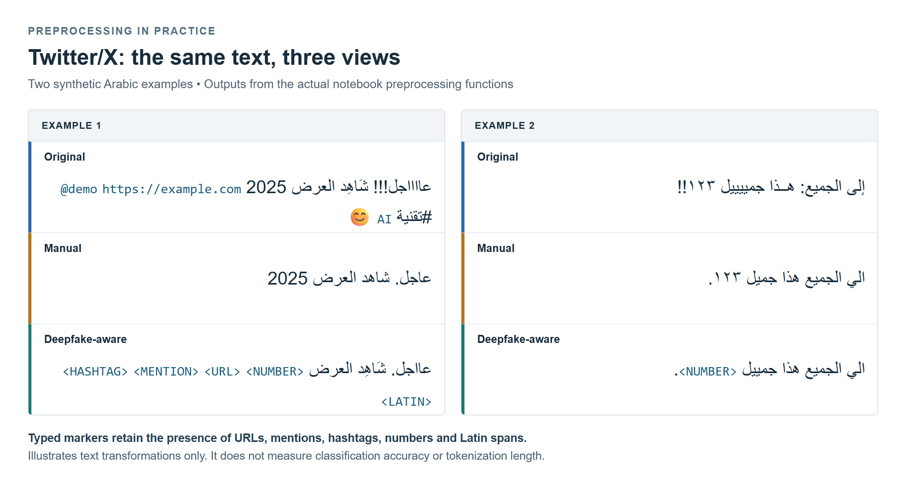
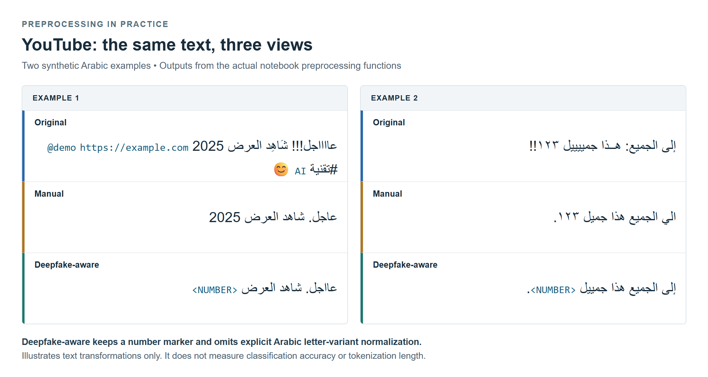
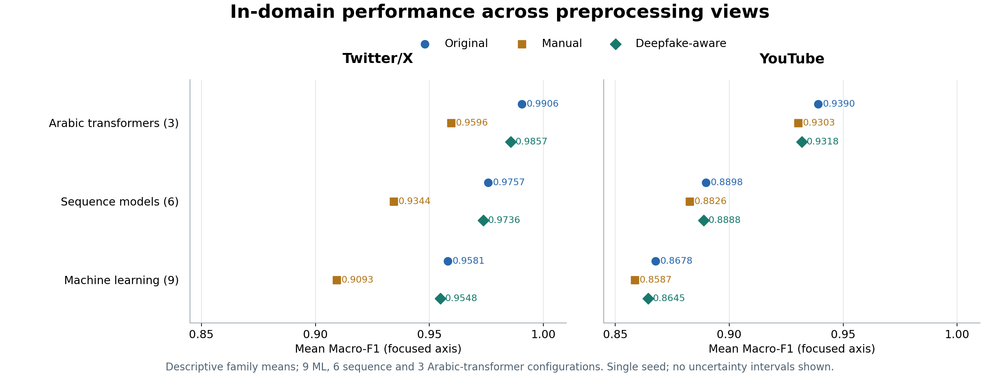

# Arabic Deepfake Text Detection

Research code for comparing text representations, model families, and preprocessing choices for Arabic human-versus-generated text classification on Twitter/X and YouTube. Experiments include in-domain evaluation and bidirectional cross-platform transfer.

Here, **deepfake text** refers to generated rewrites using deceptive strategies. The classifiers predict human versus generated text; they do not independently verify whether a statement is true.

## Experimental design

Each preprocessing view is evaluated separately using fixed data partitions:

- **Original:** the already-cleaned corpus, without additional experimental normalization.
- **Manual:** additional conventional text normalization.
- **Deepfake-aware:** task-oriented preprocessing intended to preserve potentially informative surface cues.

The main experiments compare classical machine-learning classifiers, LSTM/Bi-LSTM sequence models, and fine-tuned Arabic transformers (AraBERTv2, MARBERTv2, and CAMeLBERT). A supplementary notebook evaluates mBERT and XLM-R in-domain.

Cross-platform evaluation applies a source-platform model to the other platform without retraining. The source pipeline's preprocessing and feature/tokenization configuration must remain attached to that model. Platform, collection period, and generator differ together, so these results do not isolate a causal platform effect.

## Preprocessing examples

Each image shows **two synthetic Arabic examples**, with the same input processed under Original, Manual, and Deepfake-aware views. The displayed outputs come from the actual platform-specific functions; these are illustrations, not quotations from the restricted dataset or model predictions.

### Twitter/X



Manual preprocessing removes social-media elements and normalizes spelling. Twitter/X Deepfake-aware preprocessing represents structural elements with typed markers and retains different surface cues, as shown above.

### YouTube



YouTube Deepfake-aware preprocessing uses a number marker while removing URLs, mentions, hashtags and Latin spans; it differs from the Twitter/X implementation. Copyable text and function locations are in the [notebook guide](NOTEBOOK_GUIDE.md#preprocessing-examples-from-the-actual-functions).

## In-domain results



The Original view has the highest family mean in these experiments. Deepfake-aware preprocessing partly recovers the Manual-view reduction but does not exceed Original in the displayed family means. These are averages across 9 machine-learning, 6 sequence-model and 3 Arabic-transformer configurations—not best-model scores or results on the two illustrative texts. The shared horizontal scale is focused; no uncertainty intervals are supplied for these descriptive means. Single-seed results do not measure training-run variability.

See the [asset notes and exact aggregate values](readme_assets/README.md) for provenance. The text examples illustrate transformations; measured classification results, rather than visual cleanliness, determine effectiveness.

## Repository guide

See the [detailed notebook guide](NOTEBOOK_GUIDE.md) for all 290 code-cell locations, stage explanations, and synthetic Arabic examples processed by the actual platform functions.

| File or directory | Purpose |
| --- | --- |
| `Arabic_Deepfake_Detection_Twitter.ipynb` | Main Twitter/X training and evaluation pipeline |
| `Arabic_Deepfake_Detection_Youtube.ipynb` | Main YouTube training and evaluation pipeline |
| `Arabic_Deepfake_Detection_Multilingual.ipynb` | Supplementary mBERT and XLM-R experiments |
| `EDA.ipynb` | Dataset exploration; inspect paths before running |
| `evaluation_ml_dl.ipynb` | Artifact-based machine-learning and sequence-model evaluation |
| `evaluation_transformers.ipynb` | Artifact-based transformer evaluation |
| `hypothesis_testing_analysis.py` | Statistical analysis; writes its report under `Output/hypothesis_tests/` |
| `generate_misclassification_analysis_artifacts.py` | Error-analysis artifacts |
| `generate_reviewer_response.py` | Additional metrics and training/cost summaries from local outputs |
| `*_helpers.py` | Shared plotting and error-analysis functions |
| `scripts/check_public_release.py` (local only) | Maintainer's read-only publication check; not distributed |

`Dataset/`, `Output/`, `paper/`, `design/`, `assets/`, and `evaluation_support/` are private local working directories, not public-repository inputs. The evaluation notebooks embed their helper code; their internal builder and development tests are not distributed. Reference papers and manuscript-editing utilities are also excluded from routine staging.

## Setup

Run commands from the repository root. Create a separate environment:

```powershell
python -m venv .venv
.venv\Scripts\Activate.ps1
python -m pip install --upgrade pip
```

Install a PyTorch build appropriate for your machine using the [official installation guide](https://pytorch.org/get-started/locally/), then install the notebook and analysis dependencies:

```powershell
python -m pip install jupyterlab ipykernel nbformat nbclient numpy pandas scipy scikit-learn matplotlib seaborn gensim transformers datasets accelerate sentencepiece emoji joblib openpyxl Pillow plotly
python -m ipykernel install --user --name arabic-deepfake --display-name "Arabic Deepfake"
jupyter lab
```

Select the **Arabic Deepfake** kernel. Transformer training benefits from a compatible GPU and requires access to the relevant pretrained model files. Dependencies are not pinned to a validated lockfile; this is a starting environment, not a guarantee of bit-for-bit reproduction. Record the package versions and hardware used for each run.

## Data preparation and access

The experiments reuse platform-specific subsets of ArabiDeepfake. Raw text, split files, trained weights, and prediction-level exports are not distributed here. Data access is subject to the dataset's permissions and privacy safeguards; the repository license does not grant access to restricted data.

With authorized data access, place the existing split files in this layout:

```text
Dataset/
  Twitter_data/Twitter_data/splits_rebuilt_v4/
    train_with_meta.csv
    val_with_meta.csv
    test_with_meta.csv
  Youtube_data/Youtube_data/splits_rebuilt/
    train_with_meta.csv
    val_with_meta.csv
    test_with_meta.csv
```

The core columns are `text` and `label`, with **0 = generated** and **1 = human**. Metadata includes `dialect`, `deception_type`, and the platform's domain field (`field` for Twitter/X; `sector` for YouTube). Preserve the original split and metadata rather than generating a new random split.

The expected final experimental partitions are:

| Platform | Training | Validation | Test | Total |
| --- | ---: | ---: | ---: | ---: |
| Twitter/X | 19,800 | 5,657 | 2,829 | 28,286 |
| YouTube, after test-overlap removal | 15,846 | 2,265 | 5,654 | 23,765 |

The YouTube source split files contain 28,272 records before overlap removal. Removing 3,944 training and 563 validation records whose whitespace-normalized text occurs in the test partition yields 23,765 records; the test partition is unchanged. Do not confuse pre-removal corpus counts with final experimental counts. Exact-text removal does not establish separation of human texts from their generated counterparts when source-generation links are unavailable.

## Running the experiments

1. Review the configuration and data-loading cells. Confirm the project root, input paths, output destinations, labels, and leakage-audit counts before training. Fit learned preprocessing and features on training data only.
2. Optionally run `EDA.ipynb` to inspect the authorized local data. Its outputs may contain text samples and should remain private.
3. Run the Twitter/X and YouTube training notebooks separately. Each contains multiple model and preprocessing configurations; a full run is computationally substantial. Keep saved artifacts and metadata from the same run together under `Output/`.
4. For supplementary multilingual experiments, use `Arabic_Deepfake_Detection_Multilingual.ipynb`. Outside Google Colab, skip the final two Google Drive export cells. Its results are in-domain comparisons, not additional cross-platform experiments.
5. After the required training artifacts exist, run `evaluation_ml_dl.ipynb` and `evaluation_transformers.ipynb`. These are independent analyses of existing artifacts, not substitutes for training. Their helper source is embedded; no `evaluation_support` folder is needed to run them. Open each notebook from the repository root and run its cells in order.
6. If needed, run the standalone statistical and error-analysis scripts after checking their expected artifact paths:

```powershell
python hypothesis_testing_analysis.py
python generate_misclassification_analysis_artifacts.py
```

Do not overwrite an established experiment run with a differently configured run. Retain its configuration, seed, package versions, predictions, and split provenance for comparison.

The statistical script generates `Output/hypothesis_tests/results_and_analysis.ipynb`, a Markdown results report rather than an additional executable pipeline. Generated reports, unused preview images, and one-off manuscript-editing scripts are not part of the publication tree.

## Interpreting results

Compare preprocessing choices within the intended deployment setting: the Original view is strongest in-domain in these experiments, while Manual preprocessing can help some transfer settings. There is no universally best preprocessing view.

The experiments use a single seed. Sample-bootstrap confidence intervals describe test-sample uncertainty, not training-run variability; close scores should not be treated as stable rankings across seeds. Multilingual comparisons are task-specific fine-tuning results, not evaluations of general-purpose LLM-text detectors.

## Before publishing to GitHub

This section is for the maintainer's local working copy. The `scripts/` publication utilities are intentionally excluded from the public repository; they are not required to run the research notebooks.

Ignore rules prevent routine staging of local data, outputs, checkpoints, reference documents, and temporary files. **They do not remove files already tracked by Git, clean notebook outputs, or erase Git history.** Avoid `git add .`; stage only reviewed public files.

Clear notebook outputs in a separate release checkout/copy if you need to retain executed research notebooks locally. For example, in that release copy:

```powershell
jupyter nbconvert --ClearOutputPreprocessor.enabled=True --inplace --to notebook Arabic_Deepfake_Detection_Twitter.ipynb
```

Repeat for every notebook being published, then inspect its source, Markdown, attachments, and metadata for private information. Clearing outputs alone is not a complete privacy review.

After staging the intended files, check exactly what the next commit would contain:

```powershell
git status --short
git diff --cached --stat
python scripts/check_public_release.py
git diff --cached --check
```

The release checker scans the entire Git index, including unchanged tracked files. It rejects known private paths, common data/model/archive files, files above 10 MiB, and notebooks with saved outputs, execution counts, attachments, or widget state. It does not modify files and is not a comprehensive secret scanner. A failed check means the staged snapshot is not ready for publication.

Before staging, use `python scripts/check_public_release.py --worktree` to check the existing tracked and non-ignored untracked files. This checks the working copy, not the next commit. The publication notebooks are saved without outputs; rerunning them can recreate private text previews, so repeat the checks after execution.

For bounded publication-rule tests without training, run `python scripts/test_public_release.py`. These do not reproduce full experimental results. Also review any existing Git history before pushing: cleaning the working files does not remove historical notebook outputs. No automated check can guarantee that notebook source contains no sensitive data.

## License

Repository code is provided under the [MIT License](LICENSE). Dataset access and third-party model or document licenses are separate.
